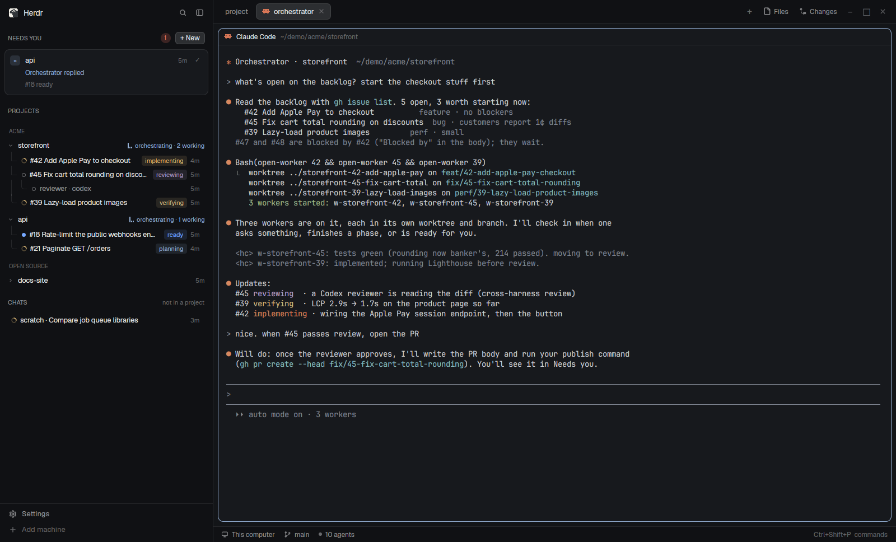

# herdr-orchestrator

**One agent to talk to per project, in [herdr](https://herdr.dev).** Each project gets an **orchestrator**, a Claude Code session whose only job is to delegate. You tell it what you want, or point it at GitHub issues, and it opens a **worker** per issue in a git worktree of its own. The worker implements and verifies the change, then gets an **independent review from the other agent harness** (Claude Code ↔ Codex) before it reports back. The orchestrator ships what is safe to ship and brings you only what needs you.



## A day with it

1. **Open a project.** Click **+ New → Open a project** and pick a repo folder (or open a herdr space at a repo's root). The project gets a pinned `project` tab and an `orchestrator` tab.
2. **Talk to the orchestrator, and only to it.** "Work on #12 and #15", "triage the open issues", "the checkout button is broken on mobile, open an issue and fix it". It plans, opens workers, starts helper agents and follows them. You don't manage workers.
3. **Watch, if you want to.** In the sidebar, the project reads **orchestrating · N working**. Expand it to see every agent it started as a tree: workers with their phase (planning → implementing → verifying → reviewing → ready), what each one is doing right now, the reviewer under it, and the terminals running its tests or builds. Click any of them for a **peek** at its terminal; you come back to where you were.
4. **Answer when you're called.** When the orchestrator replies or needs a decision, its project shows up in **Needs you**. Click the card and you're in the orchestrator's conversation, with the question or the summary at the end. Answer there, in plain words.
5. **Shipping follows the target branch.** Work aimed at a non-protected branch (development, staging…) is published by the orchestrator as soon as it is verified and reviewed; you get a one-line note with the PR link. Work that reaches a **protected** branch (`main`, `production`…) always comes to you as a decision: what changed for users, the risk and why, the proofs (tests, review verdict, CI), and the PR link. Your repo's own rules still win: if its `AGENTS.md` says only a human publishes, the orchestrator hands you the exact command.
6. **Close the laptop.** After a reboot, orchestrators reopen with their conversations; a daily prune removes worktrees whose branch is gone.

## What you get

- **A sidebar built around that flow** (it replaces herdr's Spaces and Agents lists):
  - **Needs you:** one card per project whose orchestrator replied or asks for something. The project name leads; under it, the issues waiting on you. A click opens the orchestrator; ✓ hides the card until it speaks again.
  - **Projects:** grouped by the folder that holds them. Each project is its orchestrator plus everything it started, as a tree, and your own chats in that repo. Every row shows how long it has been in its current state.
  - **Chats:** your agents that aren't in any project.
  - **+ New:** open a project or start a chat (in a project or on its own).
- **Projects that don't go away by accident.** The pinned `project` tab holds the orchestrator, its workers, the backlog of open issues (▶ worker, ✕ close as not planned) and the only "Close project…" button. If you close the orchestrator or the space by accident, it comes back within seconds, conversation included.
- **An orchestrator with a fixed role.** It is loaded as a system prompt, so it survives `/clear`. It delegates, relays workers' questions to you verbatim and passes your answers back; it never answers for you.
- **Workers per issue** (`w-<repo>-<n>`), each with its own worktree, branch and space, plus your project's setup commands. A worker won't open while its issue is blocked by another open issue, or past `max_workers`. Long commands (test suites, builds, dev servers) run in their own named terminals so you can watch them.
- **Cross-harness review.** Claude workers are reviewed by Codex and Codex workers by Claude, in a clean context, until `VERDICT: APPROVE`.
- **Resume after reboot** and **a daily prune**.

## How it works

```
Needs you ── [»] api · Orchestrator replied · #15 asks ──▶ opens the orchestrator
                                                                 │ you answer there
api   ▮▮▮ orchestrating · 2 working                              ▼
├─ ● #15 Rate-limit the public API   blocked   ◀── it passes your answer to w-api-15
├─ ⟳ #18 Migrate users to v2 schema  reviewing
│  │  running the migration tests
│  └─ ⟳ reviewer · codex
└─ ⟳ Triage of the open issues                 (a helper the orchestrator started)
```

Everything is plain herdr: spaces, tabs, `hc` terminals, templates in `~/.config/herdr-core/templates`, and mods. The scripts in `skill/scripts` do the orchestration; the `orchestrator` mod only shows state and calls them.

## Keyboard

Hover any control to see its shortcut; the tooltips read your live bindings, so they follow your changes.

| Action | Default key |
|---|---|
| **+ New**: open a project or start a chat | Ctrl+Shift+A |
| Open the orchestrator of the first **Needs you** card | Ctrl+Shift+Y |
| Go to the current project's orchestrator | Ctrl+Shift+G |
| Next / previous agent, in sidebar order | Alt+Down / Alt+Up |
| New tab / close tab | Ctrl+Shift+T / Ctrl+Shift+W |
| Go to tab N | Ctrl+1 … Ctrl+9 |
| Next / previous tab | Ctrl+Tab / Ctrl+Shift+Tab |
| Rename tab | F2 |

The first three are this mod's commands (`orchestrator.new`, `orchestrator.needs-you`, `orchestrator.project`). `install` adds them to `~/.config/herdr-app/keys.json` only when the key is free, never overwrites your bindings, and never re-adds one you deleted. They work while the sidebar is on screen.

## Requirements

- Linux (the login autostart and daily prune use XDG autostart and systemd user timers; elsewhere, run `on-login` and `prune-workers` yourself).
- [herdr-app](https://herdr.dev) ≥ 0.1.16 with herdr-core (`hc`) ≥ 0.1.20. Open herdr-app once before installing.
- [Claude Code](https://claude.com/claude-code); [Codex](https://github.com/openai/codex) for cross-harness reviews (optional).
- `git`, `gh` (logged in), `patch`, Python ≥ 3.10.

## Install

```sh
git clone https://github.com/gabrielmarcolino23z/herdr-orchestrator
herdr-orchestrator/install
```

`install` does the following, and is idempotent:
- links the skill into `~/.agents/skills` and `~/.claude/skills`;
- installs the hc templates and the herdr mods;
- puts the orchestrator sidebar in your layout. A built-in layout is first cloned to a personal `orchestrator` layout;
- sets up the login autostart and the daily prune;
- **asks** before adding a `SessionStart` hook to `~/.claude/settings.json` and `~/.codex/hooks.json`, which is what makes resume and reopen-with-conversation work;
- runs the quick tests.

In Codex, approve the new hook once in `/hooks`.

Then follow [A day with it](#a-day-with-it).

**Update:** `git pull && ./install`. Run `./install` again **after every herdr-app update**: it re-applies the two small patches to herdr's current `tabs` and `menu` mods and tells you if one no longer fits.

## Configuration

Defaults are in `skill/config.json`. Put your overrides in `~/.config/herdr-orchestrator/config.json` and run `install`:

```json
{
  "groups": { "order": ["acme", "oss"], "names": { "oss": "Open source" } },
  "models": { "orchestrator": "opus", "worker_claude": "opus", "reviewer_claude": "opus" },
  "codex_args": ["-c", "model_reasoning_effort=high"],
  "max_workers": 4,
  "prune_time": "08:30",
  "publish": "gh pr create --head {branch} --body-file {pr_file}",
  "protected_branches": ["main", "production"],
  "projects": {
    "my-app": {
      "setup": ["npm ci", "cp ../my-app/.env .env"],
      "teardown": ["docker compose down -v"],
      "publish": "npm run release-pr -- {branch}",
      "protected_branches": ["main"]
    }
  }
}
```

`protected_branches` are the branches the orchestrator never merges into on its own (default `main`, `master`, `production`). `groups` are the folders that hold your repos (`~/code/acme/api` is in `acme`). The orchestrator and workers follow each repo's `AGENTS.md` / `CLAUDE.md` for the definition of done and for publishing. Put those rules there and not here.

## Safety

Workers and orchestrators run with **your** Claude Code and Codex permission settings. If you run them in auto/full-access modes, they act without asking. herdr-orchestrator adds guard rails around the workflow: worker limit, blockers, independent review, questions go to you, protected branches never merged without you, and your repo's own publishing rules on top. Workers read issue text, which anyone who can open an issue writes: on public repos, treat it as untrusted. It is **not** a sandbox: pick your agents' permission modes deliberately.

## Test

```sh
~/.agents/skills/herdr-orchestrator/scripts/test           # quick: ~36 checks
~/.agents/skills/herdr-orchestrator/scripts/test --full    # end to end in a throwaway project (~3 min, a cheap model)
```

## Uninstall

1. Switch back to a built-in layout (`ctrl-shift-l`).
2. Delete these mods: `~/.config/herdr-app/mods/{orchestrator,orc-tabs,orc-menu}`.
3. Delete these files:
   - the 4 templates in `~/.config/herdr-core/templates/` (worker-*, reviewer-*);
   - `~/.config/autostart/herdr-orchestrator-login.desktop`;
   - `~/.config/systemd/user/herdr-orchestrator-prune.*`;
   - `~/.config/environment.d/99-zz-herdr-orchestrator-mise.conf`;
   - the skill links in `~/.agents/skills/` and `~/.claude/skills/`;
   - `~/.local/state/herdr-orchestrator`.
4. Remove the `mark-session` hooks from your Claude and Codex settings.

## Related

herdr has a lively mods scene, and several projects explore the same idea, a coordinator with workers:
- [coordinator](https://github.com/petekp/coordinator);
- [claude-herdr-orchestrator](https://github.com/contursofran/claude-herdr-orchestrator);
- [herdr-t3-inbox](https://github.com/JinJieBeWater/herdr-t3-inbox), a T3 Code-style inbox;
- [herdr-issues](https://github.com/jankeesvw/herdr-issues);
- [herdr-agent-resume](https://github.com/thuanlm215/herdr-agent-resume).

herdr-orchestrator's take:
- you talk to one agent per project;
- projects can't vanish by accident;
- every worker gets a review from the other harness;
- the whole issue → ready-to-publish flow is in one place.

## License

Apache-2.0. `herdr/patches` modify mods that ship with herdr-app (Apache-2.0); see [NOTICE](NOTICE).
