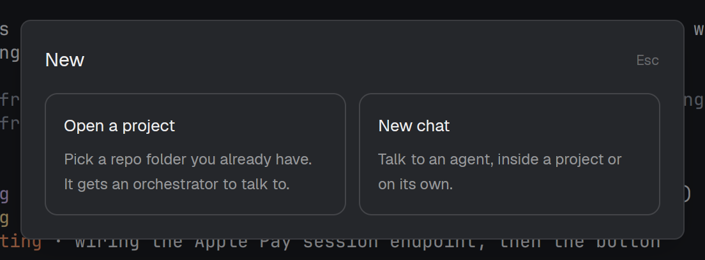
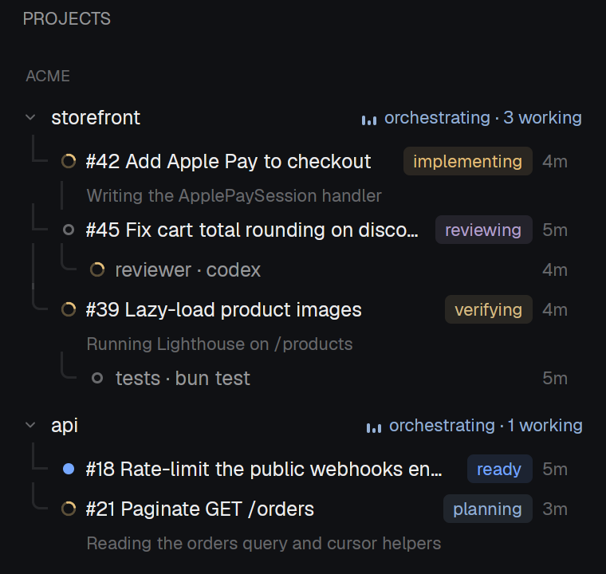
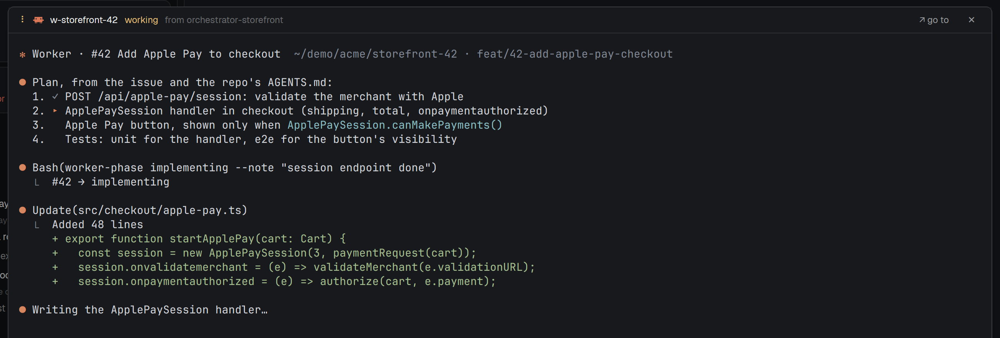
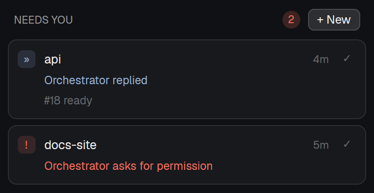
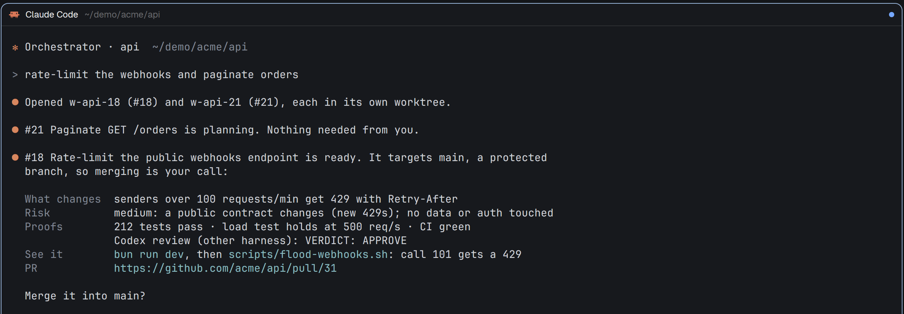
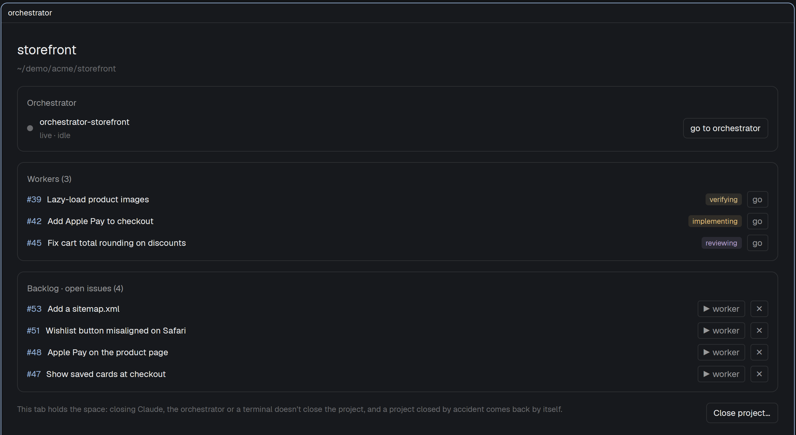
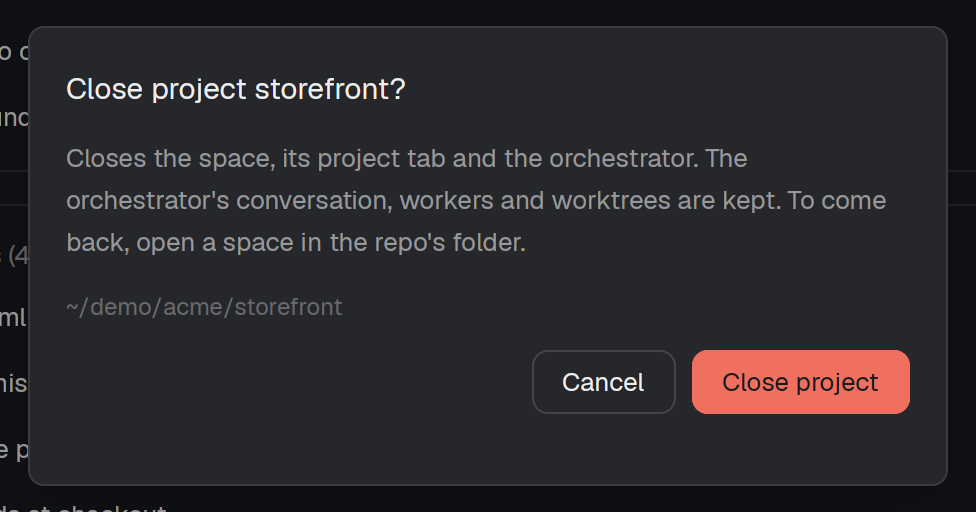
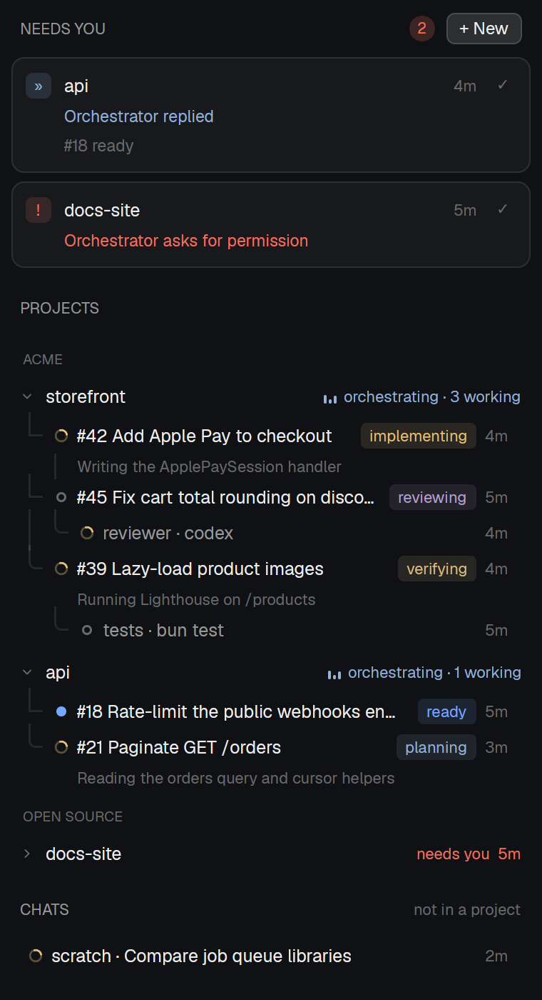
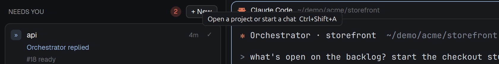

# herdr-orchestrator

**One agent to talk to per project, in [herdr](https://herdr.dev).** Each project gets an **orchestrator**: a Claude Code session whose only job is to delegate. You tell it what you want, or point it at GitHub issues, and it opens a **worker** per issue, each in a git worktree of its own. A worker implements and verifies the change, then gets an **independent review from the other agent harness** (Claude Code ↔ Codex) before it reports back. The orchestrator ships what is safe to ship and brings you only what needs you. The herdr sidebar is rebuilt around that flow.


<sub>Every picture here comes from a fake, isolated demo (the Acme repos, fake agents); see [docs/preview](docs/preview).</sub>

## Install

**Requirements**

- Linux (the login autostart and daily prune use XDG autostart and systemd user timers; elsewhere, run `on-login` and `prune-workers` yourself).
- [herdr-app](https://herdr.dev) ≥ 0.1.16 with herdr-core (`hc`) ≥ 0.1.20. Open herdr-app once before installing.
- [Claude Code](https://claude.com/claude-code); [Codex](https://github.com/openai/codex) for cross-harness reviews (optional).
- `git`, `gh` (logged in), `patch`, Python ≥ 3.10.

```sh
git clone https://github.com/gabrielmarcolino23z/herdr-orchestrator
herdr-orchestrator/install
```

`install` does the following, and is idempotent:
- links the skill into `~/.agents/skills` and `~/.claude/skills`;
- installs the hc templates and the herdr mods;
- puts the orchestrator sidebar in your layout. A built-in layout is first cloned to a personal `orchestrator` layout;
- adds the [keyboard shortcuts](#keyboard) whose keys are free;
- sets up the login autostart and the daily prune;
- **asks** before adding a `SessionStart` hook to `~/.claude/settings.json` and `~/.codex/hooks.json`, which is what makes resume and reopen-with-conversation work;
- runs the quick tests.

In Codex, approve the new hook once in `/hooks`.

**Update:** `git pull && ./install`. Run `./install` again **after every herdr-app update**: it re-applies the two small patches to herdr's current `tabs` and `menu` mods and tells you if one no longer fits.

## A tour, step by step

### 1. Open a project

Click **+ New** at the top of the sidebar (or press Ctrl+Shift+A) and choose **Open a project**. Pick a repo folder you already have, wherever it lives. Opening a herdr space at a repo's root works too.



The project gets its own space with two tabs: a pinned **`project`** tab (step 6) and an **`orchestrator`** tab, where its orchestrator is already running. **New chat** in the same dialog starts a plain Claude session, inside a project (it shows under that project) or on its own (it shows under **Chats**).

### 2. Talk to the orchestrator, and only to it

Ask in plain words: "work on #42 and #45", "triage the open issues", "the checkout button is broken on mobile, open an issue and fix it". The orchestrator plans, opens workers, starts helper agents and follows them. You don't manage workers.

- Its role is loaded as a system prompt, so it survives `/clear`.
- Each worker (`w-<repo>-<n>`) gets its own worktree, branch and space, plus your project's setup commands. A worker won't open while its issue is blocked by another open issue, or past `max_workers`.
- When a worker is done, it is reviewed by the **other harness** in a clean context (Claude workers by Codex, Codex workers by Claude) until `VERDICT: APPROVE`.
- Workers report to their orchestrator by name. It brings their questions to you verbatim and passes your answers back; it never answers for you.

The big picture at the top is this step: the storefront orchestrator read the backlog, opened three workers and reports how they're doing.

### 3. Watch the work, if you want to

In the sidebar, a project whose workers are running reads **orchestrating · N working**. Expand it to see everything its orchestrator started, as a tree:



- **Workers**, with their issue and **phase**: planning → implementing → verifying → reviewing → ready (or blocked).
- Under a working worker, an *italic line* with **what it is doing right now** (the status message its agent reports).
- Under a worker, its **reviewer** (`reviewer · codex`) and its **helper terminals**: long commands (test suites, builds, dev servers) run in their own named terminals, like `tests · bun test`, so you can watch them.
- Your own chats in that repo, as `your chat · …`.
- Every row shows how long it has been in its current state.

Click any worker, reviewer or terminal for a **peek** at its terminal over the tab; close it and you're back where you were. Alt+Down / Alt+Up walk through agents in sidebar order.



### 4. Answer when you're called: Needs you

When an orchestrator replies or needs a decision, its project shows up in **Needs you**, at the top of the sidebar:



- One card per project: **» Orchestrator replied**, or **! asks for permission**. Under it, the issues waiting on you (`#18 ready`, `#15 asks`).
- Click the card (or press Ctrl+Shift+Y for the first one) and you land in that orchestrator's conversation, with the question or the summary at the end. Answer there.
- ✓ hides a card until that orchestrator speaks again.
- Workers never make cards: they report to their orchestrator, which decides what reaches you.

### 5. Shipping follows the target branch

- Work aimed at a **non-protected** branch (development, staging…) is published by the orchestrator as soon as it is verified and reviewed; you get a one-line note with the PR link and the risk.
- Work that reaches a **protected** branch (`main`, `production`…, see `protected_branches` in [Configuration](#configuration)) is never merged on its own. It comes to you as a decision: what changed for users, the risk and why, the proofs (tests, review verdict, CI), how to see it working, and the PR link.



Your repo's own rules still win: the orchestrator and workers follow its `AGENTS.md` / `CLAUDE.md` for the definition of done and for publishing. If they say only a human publishes, the orchestrator hands you the exact command.

### 6. Projects that don't vanish

The pinned **`project`** tab is the project's home: its orchestrator (with **go to orchestrator**, or **▶ open orchestrator** when it's stopped), its workers with their phases, and the **backlog** of open GitHub issues that no worker has yet. **▶ worker** asks the orchestrator to open a worker for that issue; **✕** closes it on GitHub as *not planned* (after a confirmation; you can reopen it there).



Projects don't go away by accident. The tab has no ×, and if you close the orchestrator or the space by accident, it comes back within seconds, conversation included. **Close project…** (here, or in the tab's menu) is the one way to close a project on purpose, and it asks first:



### 7. Close the laptop

After a reboot, herdr brings your terminals back as plain shells; herdr-orchestrator types each agent back in with its conversation (`--resume`): orchestrators, workers and your chats, Claude Code and Codex alike. This needs the `SessionStart` hook that `install` offers. Once a day, a prune removes worktrees whose branch is gone from the remote, along with their spaces and records.

## The sidebar at a glance



It replaces herdr's Spaces and Agents lists:

- **Needs you:** one card per project whose orchestrator replied or asks for something, and **+ New**.
- **Projects:** grouped by the folder that holds them (`groups` in the config). Each project is its orchestrator plus everything it started, as a tree, and your own chats in that repo. In each group, projects with workers come first and start expanded. Click a project's name to talk to its orchestrator; the chevron only folds it.
- **Chats:** your agents that aren't in any project.
- **Other spaces:** folded; spaces without agents.

Everything is plain herdr: spaces, tabs, `hc` terminals, templates in `~/.config/herdr-core/templates`, and mods. The scripts in `skill/scripts` do the orchestration; the `orchestrator` mod only shows state and calls them. The details are in [RECIPE.md](RECIPE.md).

<br clear="right">

## Keyboard

Hover any control to see its shortcut; the tooltips read your live bindings, so they follow your changes.



| Action | Default key |
|---|---|
| **+ New**: open a project or start a chat | Ctrl+Shift+A |
| Open the orchestrator of the first **Needs you** card | Ctrl+Shift+Y |
| Go to the current project's orchestrator | Ctrl+Shift+G |
| Next / previous agent, in sidebar order | Alt+Down / Alt+Up |
| New tab / close tab | Ctrl+Shift+T / Ctrl+Shift+W |
| Go to tab N | Ctrl+1 … Ctrl+9 |
| Next / previous tab | Ctrl+Tab / Ctrl+Shift+Tab |
| Rename tab | F2 |

The first three are this mod's commands (`orchestrator.new`, `orchestrator.needs-you`, `orchestrator.project`). `install` adds them to `~/.config/herdr-app/keys.json` only when the key is free, never overwrites your bindings, and never re-adds one you deleted. They work while the sidebar is on screen.

## Configuration

Defaults are in `skill/config.json`. Put your overrides in `~/.config/herdr-orchestrator/config.json` and run `install`:

```json
{
  "groups": { "order": ["acme", "oss"], "names": { "oss": "Open source" } },
  "models": { "orchestrator": "opus", "worker_claude": "opus", "reviewer_claude": "opus" },
  "codex_args": ["-c", "model_reasoning_effort=high"],
  "max_workers": 4,
  "prune_time": "08:30",
  "publish": "gh pr create --head {branch} --body-file {pr_file}",
  "protected_branches": ["main", "production"],
  "projects": {
    "my-app": {
      "setup": ["npm ci", "cp ../my-app/.env .env"],
      "teardown": ["docker compose down -v"],
      "publish": "npm run release-pr -- {branch}",
      "protected_branches": ["main"]
    }
  }
}
```

`protected_branches` are the branches the orchestrator never merges into on its own (default `main`, `master`, `production`). `groups` are the folders that hold your repos (`~/code/acme/api` is in `acme`). The orchestrator and workers follow each repo's `AGENTS.md` / `CLAUDE.md` for the definition of done and for publishing. Put those rules there and not here.

## Safety

Workers and orchestrators run with **your** Claude Code and Codex permission settings. If you run them in auto/full-access modes, they act without asking. herdr-orchestrator adds guard rails around the workflow: worker limit, blockers, independent review, questions go to you, protected branches never merged without you, and your repo's own publishing rules on top. Workers read issue text, which anyone who can open an issue writes: on public repos, treat it as untrusted. It is **not** a sandbox: pick your agents' permission modes deliberately.

## Test

```sh
~/.agents/skills/herdr-orchestrator/scripts/test           # quick: ~36 checks
~/.agents/skills/herdr-orchestrator/scripts/test --full    # end to end in a throwaway project (~3 min, a cheap model)
```

The README images are reproducible from a fake, isolated demo (its own HOME, hc session and herdr-app window, no network): `docs/preview/run.sh`, wait ~5 minutes, then `docs/preview/shots.sh`; `docs/preview/down.sh` stops it.

## Uninstall

1. Switch back to a built-in layout (`ctrl-shift-l`).
2. Delete these mods: `~/.config/herdr-app/mods/{orchestrator,orc-tabs,orc-menu}`.
3. Delete these files:
   - the 4 templates in `~/.config/herdr-core/templates/` (worker-*, reviewer-*);
   - `~/.config/autostart/herdr-orchestrator-login.desktop`;
   - `~/.config/systemd/user/herdr-orchestrator-prune.*`;
   - `~/.config/environment.d/99-zz-herdr-orchestrator-mise.conf`;
   - the skill links in `~/.agents/skills/` and `~/.claude/skills/`;
   - `~/.local/state/herdr-orchestrator`.
4. Remove the `mark-session` hooks from your Claude and Codex settings.

## Related

herdr has a lively mods scene, and several projects explore the same idea, a coordinator with workers:
- [coordinator](https://github.com/petekp/coordinator);
- [claude-herdr-orchestrator](https://github.com/contursofran/claude-herdr-orchestrator);
- [herdr-t3-inbox](https://github.com/JinJieBeWater/herdr-t3-inbox), a T3 Code-style inbox;
- [herdr-issues](https://github.com/jankeesvw/herdr-issues);
- [herdr-agent-resume](https://github.com/thuanlm215/herdr-agent-resume).

herdr-orchestrator's take:
- you talk to one agent per project;
- projects can't vanish by accident;
- every worker gets a review from the other harness;
- the whole issue → ready-to-publish flow is in one place.

## License

Apache-2.0. `herdr/patches` modify mods that ship with herdr-app (Apache-2.0); see [NOTICE](NOTICE).
