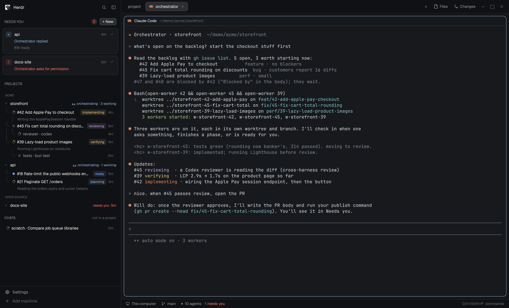

# herdr-orchestrator

Every git repo you open becomes a project with one agent to talk to, its orchestrator. The orchestrator delegates GitHub issues to workers in their own worktrees and spaces, each reviewed by the other agent harness, and brings you only what needs you. The sidebar is rebuilt around that: Needs you, Projects (each orchestrator with its workers as a tree) and Chats.

## What you see

- **Sidebar** (one mod, `orchestrator`, view `sidebar`, in place of herdr's Spaces and Agents lists), on `chrome`, 12.5px:
  - **NEEDS YOU** (11px, semibold, muted) with a round count (blocked color) and "+ New" (a small bordered button) on the same line.
    - One card per project whose orchestrator replied (`»`, accent) or asks for permission (`!`, blocked): a tinted 18px badge, the **project name** (semibold) with the age, "Orchestrator replied" in the badge color, and the issues waiting on you (`#12 ready · #15 asks`, dim). ✓ hides it. Workers never make cards: they report to their orchestrator.
    - Under the cards: "Hidden (n) · show again". Empty: "All clear. A chat that needs you shows up here."
  - **PROJECTS:** group labels (11px, dim; the folder holding the repos, config order first, then alphabetical). One row per project:
    - a chevron (only when there is something to expand), the project name (semibold), and its orchestrator's state on the right: **orchestrating · N working**, three accent bars looping in height, when its workers run and it doesn't; otherwise "thinking", "needs you", "replied", or "no orchestrator"; idle shows only the time.
    - Group labels: 10px uppercase, dim, with a chevron; a click folds the group (remembered in localStorage `orchestrator.expanded` as `group:<name>`), and a folded group shows "N projects · M working" (accent while working).
    - Expanded: a tree drawn with 1.5px border lines (elbow rounded on the last item). Each level is a slot as tall as its row and rows have no gap, so a non-last item's line runs unbroken through the rows under it (its activity line, reviewers, terminals) to its next sibling; elbows meet the row's middle; nested lines sit under the parent row's status mark. It lists the workers (status mark, `#n title`, phase pill tinted with its color, time) and any other agent the orchestrator started (its title); under a working worker, an italic line with what it is doing (its OSC 7501 message); under each worker, its reviewer (`reviewer · codex`) and its helper terminals (`tests · bun test`); then "your chat · …" rows for other agents in that repo.
    - Projects with workers are expanded by default and sorted first.
  - **CHATS** ("not in a project", right): agents outside any project, as `space · title` rows.
  - **Other spaces (n):** folded; spaces without agents.
- **Status marks:** working = spinner (working color); blocked = dot (blocked); done = dot (done); idle = ring (idle).
- **Phase pills:** planning ansi4, implementing working, verifying ansi3, reviewing ansi5, ready done, blocked blocked.
- **Project tab (`project`, first in each project space, no close button):** the repo name and path, an "Orchestrator" card (state, "go to orchestrator" / "▶ open orchestrator"), "Workers (n)", "Backlog · open issues (n)" (with `▶ worker` and `✕`), and "Close project…".
- **+ New dialog:** "Open a project" (system folder picker) and "New chat". New chat has a title field and "Where" chips (each project, "On its own"), wrapping onto more lines as projects add up; the dialog grows to fit. A picked folder that isn't a git repo gets "This folder isn't a git repo" with **Initialize git here** (`git init -b main`: no commit, no remote; then the project opens) or Back.

## How it behaves

- **Clicking a Needs you card opens that project's orchestrator** (`pane.focus`). You only talk to orchestrators.
- **Clicking a project's name** opens its orchestrator, starting it with `ensure-projects` if needed. The chevron only folds.
- **Clicking a worker, reviewer or helper terminal** peeks at it (`terminal.peek`); a chat opens its terminal.
- **✓ on a card** hides it (shared state `orchestrator.inbox`) until its source changes. 
- **Projects can't be closed by accident.**
  - A project space without its `project` tab, or a registered project without a space for more than 8 s, is handed to `ensure-projects`, which recreates it with the orchestrator's last conversation.
  - "Close project…" (project tab, or the tab menu) is the only way to close one: it shows a confirmation dialog.
- **Workers report to `orchestrator-<repo>` by name.** The orchestrator brings their questions to you verbatim and passes your answers back.
- **Publishing follows the target branch** (`protected_branches`): the orchestrator publishes verified, reviewed work into other branches itself and brings work for protected branches to you as a decision; the repo's AGENTS.md wins.
- **After a reboot,** agents are retyped into their recovered shells with `--resume`.
- **Daily,** worktrees whose branch is gone from the remote are removed, along with their spaces and records.

## Built from

- **Layout:** the sidebar column's list block is `{mod: "orchestrator", props: {view: "sidebar"}}`, and the tab bar is `orc-tabs`.
- **The `orchestrator` mod:** views `sidebar` (the default), `new`, `project` (`props.repo`) and `close` (a dialog; `props.folder` / `props.space`); `lib.js` holds shared helpers.
  - It uses `agents()`, `terminals()` (`name`, `parent`, `labels.repo`, `status_ms`), `spaces()`, `run` (`pane.focus`, `terminal.peek`, `tab.new`, `space.new`), `shared` / `setShared`, `pickFolder`, `openOverlay`, `watchFolder`, `readTextFile` and `exec`.
  - It runs `git`, `gh` and the skill's scripts.
- **orc-tabs and orc-menu:** herdr's `tabs` and `menu` mods with two small patches: the project tab has no ×, and its menu offers "Close project…".
- **Scripts (Python):**
  - `ensure-projects` (anchor, orchestrator, registry, recreation, close);
  - `open-worker` and `start-agent` (handles folder trust dialogs);
  - `worker-phase` (phase, note, events.jsonl), `prune-workers`, `resume-agents`, `mark-session` (a SessionStart hook);
  - `with-tools`, `on-login`, `install`, `test`.
- **hc templates:** `worker-claude`, `worker-codex`, `reviewer-claude`, `reviewer-codex`. The orchestrator's role is `skill/orchestrator.md` (`--append-system-prompt-file`).
- **State** lives in `~/.local/state/herdr-orchestrator/`: projects.json, workers/, orchestrators/, pr/, events.jsonl and ui.json.

## Watch out

- **herdr closes a space when its last tab closes.** The mod tab (`project`) keeps project spaces alive, and the registry plus the sidebar timer bring them back.
- **`hc get` answers for finished terminals too.** "Live" means `state == "live"`.
- **New folders show a trust dialog** in Claude Code ("Yes, I trust this folder" under a selected "No, exit": down, enter) and Codex ("Trust and continue": enter). A template's first message is lost behind it and must be resent. Keys sent while herdr adopts the terminal (a resize and redraw) can be lost: `accept_trust` polls up to 60–90 s, checks that the dialog went away and presses again if not (only enter when "Yes" is already selected, since another down could wrap to "No, exit").
- **A project needs a git repo.** `ensure-projects --create` on a folder outside any repo exits 3; `--init` runs `git init -b main` first.
- **herdr-core terminals don't read the shell rc,** so tools from version managers (mise) need `with-tools` or the session PATH.
- **Codex** needs `--no-daemon` and asks once before running new hooks (`/hooks`).
- **Never keep a `cx`; `new` is a JavaScript keyword** (the view object is `newDialog`).
- **The patches target herdr-app 0.1.16 mods.** Re-run `install` after herdr updates.

## Done when

- `test` passes (~36 checks), and `test --full` passes end to end:
  1. create a project;
  2. close its space and anchor, and both come back;
  3. the orchestrator runs with its role;
  4. a worker opens and sets its phase;
  5. prune clears it;
  6. Close project closes the space for good.
- In the sidebar, a project with running workers reads "orchestrating · N working", its workers sit under it as a tree, and clicking a Needs you card lands in that project's orchestrator.
